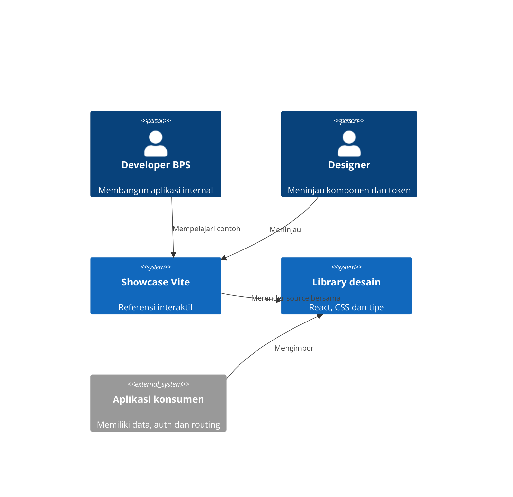
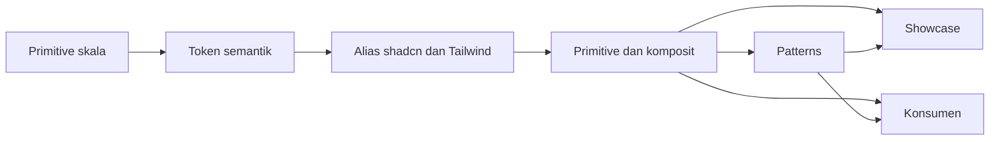
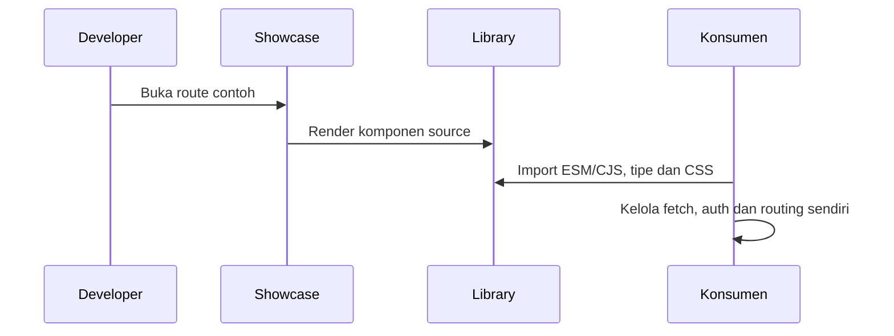

# Arsitektur BPS Kaltara Design System

## Prinsip

Satu source tree untuk library privat dan showcase SPA. Primitive dimiliki repo melalui shadcn/ui dan dibangun di atas Radix; komposit/patterns merangkai primitive, pages merangkai demo. Konsumen mengambil kontrak dari public exports, bukan folder internal sembarang.

## Tech stack

Resolved lockfile (dokumen runtime kedua): React 19.2.6, TypeScript 6.0.3, Vite 8.0.11, Vitest 4.1.5. Bun 1.3.14 dari manifest; Node >=20 untuk vitest dan tsc. Tailwind 4 CSS-first, React Router 7, shadcn/ui new-york, Radix UI, Testing Library/jsdom.

## System context

## Struktur dan lapisan

| Area | Isi |
|---|---|
| `src/components/ui/` | Primitive dan komposit BPS |
| `src/components/patterns/` | Pola tingkat tinggi |
| `src/hooks/` | Hooks publik |
| `src/pages/` | Halaman showcase/prototype |
| `src/components/layout/`, `showcase/` | Navigasi/helper showcase |
| `src/index.ts`, `src/utils.ts` | Barrel dan utilitas entry |
| `tokens.css` | Otoritas token dan @theme/utilitas |
| `colors_and_type.css` | Entry all-in-one dengan preflight, mengimpor tokens |
| `fonts.css` | CDN opsional |
| `ui_kits/dashboard/` | Prototype terpisah |

Tiga lapis konseptual A primitive → B semantic → C compatibility/@theme. Alias shadcn secara fisik berada dalam blok semantic. Jangan menghidupkan token per-komponen lama. Bare HSL memakai hsl(var(--token)); warm-50/100/200 sudah terbungkus hsl sehingga var langsung, atau versi -hsl mentah. Rincian normatif: [DESIGN](../DESIGN.md).

## Aliran request

Library build memakai preserveModules dan preserveEntrySignatures strict, dua output ESM/CJS serta declarations. Semua runtime/peer dependency dieksternalkan agar tidak membundel React atau shim require bermasalah. CSS source tambahan disalin oleh scripts/copy-css-assets.mjs. Build showcase dan library sama-sama memakai dist; jangan menganggap output keduanya tersedia bersamaan setelah build terakhir.

## Model keamanan

Data/URL/file/form eksternal tidak tepercaya. Sanitasi bila HTML mentah memang dibutuhkan, jangan mencatat PII atau credential. Font produksi di bawah kendali konsumen; CDN opt-in. Boundary RSC: modul dengan hooks/interaksi tetap client, utils terpisah murni; jangan menambahkan Next.js dependency ke showcase/library untuk menyelesaikan routing konsumen.

## Integrasi eksternal

GitHub Packages restricted menyediakan paket. Showcase memuat font melalui link pada index.html; fallback tetap dapat dibaca bila CDN terhalang. Docker/Traefik dan release CI dijelaskan di [operasi](operations.md).

## Kontrak lint

ESLint di eslint.config.js untuk source; CI memeriksa directive use client pada komponen UI yang memakai hooks. Alias internal @/ ke src, named export dan props types publik; test berdampingan. Skema tokens dan API tetap perlu review karena lint bukan bukti integrasi konsumen.

## Design decisions

Owned shadcn source memudahkan perubahan lokal tetapi pembaruan upstream perlu manual. Tiga lapis token memisahkan skala dari peran dan kompatibilitas. Vite menghasilkan ESM/CJS/types/subpath; Tailwind 4 CSS-first mengganti preset lama. Motion memakai CSS dan React yang sudah ada, sesuai [ADR 0002](adr/0002-no-motion-js-dependency.md); format ADR dijelaskan [ADR 0001](adr/0001-record-architecture-decisions.md).

## Pengecualian

Directive use client hanya untuk kompatibilitas konsumen RSC; repo bukan Next.js. Contoh Next.js/Laravel/HTML di [guide](guide.md) adalah integrasi konsumen. Shim tailwind-preset deprecated untuk kompatibilitas, bukan pola baru.
