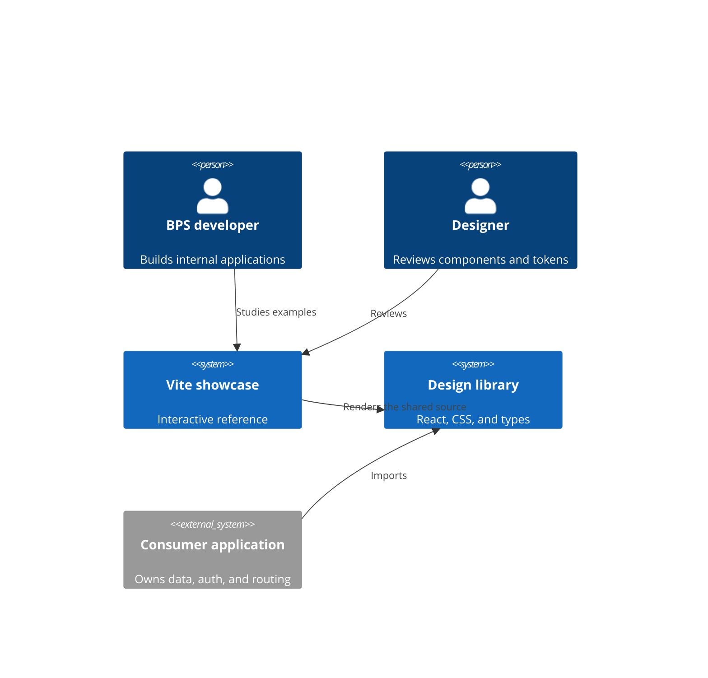
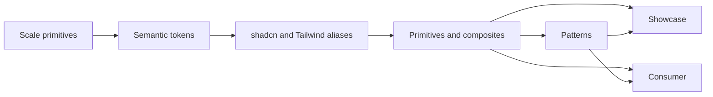
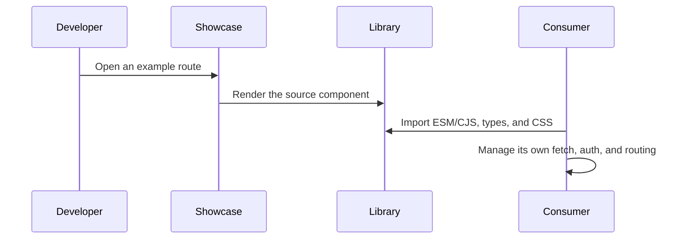

# BPS Kaltara Design System Architecture

## Principles

One source tree for the private library and the showcase SPA. The repo owns the primitives through shadcn/ui, built on Radix; composites/patterns assemble the primitives, and pages assemble the demos. Consumers take the contract from the public exports, not from arbitrary internal folders.

## Tech stack

Resolved lockfile (a second runtime document): React 19.2.6, TypeScript 6.0.3, Vite 8.0.11, Vitest 4.1.5. Bun 1.3.14 from the manifest; Node 24 (`.node-version`) for vitest and tsc. Tailwind 4 CSS-first, React Router 7, shadcn/ui new-york, Radix UI, Testing Library/jsdom.

## System context

## Structure and layers

| Area | Contents |
|---|---|
| `src/components/ui/` | Primitives and BPS composites |
| `src/components/patterns/` | High-level patterns |
| `src/hooks/` | Public hooks |
| `src/pages/` | Showcase/prototype pages |
| `src/components/layout/`, `showcase/` | Showcase navigation/helpers |
| `src/index.ts`, `src/utils.ts` | The barrel and the utility entry |
| `tokens.css` | The token authority and @theme/utilities |
| `colors_and_type.css` | The all-in-one entry with preflight, imports tokens |
| `fonts.css` | Optional CDN |
| `ui_kits/dashboard/` | A separate prototype |

Three conceptual layers: A primitive → B semantic → C compatibility/@theme. The shadcn aliases physically live in the semantic block. Do not bring back the old per-component tokens. Bare HSL uses hsl(var(--token)); warm-50/100/200 are already wrapped in hsl so use the var directly, or the raw -hsl version. Normative details: [DESIGN](../DESIGN.md).

## Request flow

The library build uses preserveModules and strict preserveEntrySignatures, two outputs ESM/CJS plus declarations. All runtime/peer dependencies are externalized so React or a problematic require shim is not bundled. Additional source CSS is copied by scripts/copy-css-assets.mjs. The showcase and library builds both use dist; do not assume the output of both is available together after the last build.

## Security model

External data/URLs/files/forms are untrusted. Sanitize if raw HTML is really needed, and do not log PII or credentials. Production fonts are under the consumer's control; the CDN is opt-in. The RSC boundary: modules with hooks/interaction stay client, utils are separate and pure; do not add a Next.js dependency to the showcase/library to solve consumer routing.

## External integrations

Restricted GitHub Packages provides the package. The showcase loads fonts through a link in index.html; the fallback stays readable if the CDN is blocked. Docker/Traefik and release CI are described in [operations](operations.md).

## Lint contract

ESLint in eslint.config.js for the source; CI checks the use client directive on UI components that use hooks. The internal alias @/ to src, named exports and public props types; tests next to the source. The token and API schemas still need review because lint is not proof of consumer integration.

## Design decisions

Owned shadcn source makes local changes easy but upstream updates need to be manual. The three token layers separate the scale from roles and compatibility. Vite produces ESM/CJS/types/subpaths; Tailwind 4 CSS-first replaces the old preset. Motion uses the CSS and React that already exist, according to [ADR 0002](adr/0002-no-motion-js-dependency.md); the ADR format is described in [ADR 0001](adr/0001-record-architecture-decisions.md).

## Exceptions

The use client directive is only for RSC consumer compatibility; the repo is not Next.js. The Next.js/Laravel/HTML examples in the [guide](guide.md) are consumer integration. The tailwind-preset shim is deprecated for compatibility, not a new pattern.
