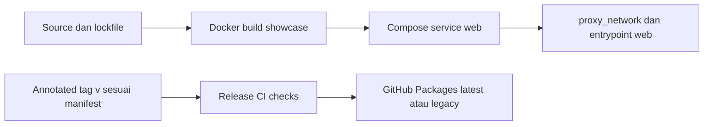

# Operasi BPS Kaltara Design System

## Environment

| Lingkungan | Konfigurasi |
|---|---|
| Development | Vite http://localhost:5173 |
| Showcase produksi | Host design.kaltarastats.id dalam docker-compose.yml; internal 8081 |
| Library v4 | main, dist-tag latest |
| Library v3 legacy | v3, dist-tag legacy |

URL HTTPS dipakai dokumentasi produk, tetapi Compose mengatur entrypoint web tanpa label TLS. Terminasi TLS aktual, staging, SSH host/user/path dan kontak: diisi operator — belum ditetapkan; jangan mengklaim websecure terkonfigurasi.

## Environment variables

Showcase tidak mendeklarasikan credential runtime; Docker memakai NODE_ENV=production. Publikasi memakai NODE_AUTH_TOKEN dari GITHUB_TOKEN workflow; konsumen registry privat memakai token read:packages di environment/home npmrc. Jangan commit token. Registry scope @bpsprovkaltara menunjuk https://npm.pkg.github.com.

## Build dan image

Dockerfile dua stage node:20-bookworm-slim, corepack enable, install frozen-lockfile --ignore-scripts sebelum source lengkap, lalu pnpm run build showcase. Runtime memasang serve@^14.2.4, menyalin dist, user non-root node, port 8081 dan serve dist -l 8081 -s -n (SPA fallback tanpa clipboard).

Library build menghasilkan ESM/CJS/types, compiled styles.css, raw tokens.css dan fonts.css. Output dist dipakai bersama build showcase; artefak library dan Docker showcase harus dibangun sesuai target, bukan mengasumsikan satu dist memenuhi keduanya.

## Deploy procedure



Traefik harus sudah berjalan dengan entrypoint yang sesuai; external network proxy_network harus tersedia.

```bash
docker network inspect proxy_network
# Hanya bila jaringan belum tersedia dan operator mengelolanya:
docker network create proxy_network
docker build -t design-system:latest .
docker run --rm -p 8081:8081 design-system:latest
docker compose up -d --build
docker compose ps
docker compose logs --tail=100
```

Compose service web, container design-system, restart unless-stopped; router host design.kaltarastats.id, entrypoint web, backend port 8081. Komentar Nginx dalam Compose historis; runtime sebenarnya serve.

CI ci.yml pada push/PR main dan v3: frozen install → typecheck → lint → pemeriksaan client directive → test → build:lib → build. Bukan pipeline deploy Docker. release.yml pada tag v*: install/typecheck/lint/test, cocokkan tag dengan package version, dist-tag legacy untuk major 3 dan latest untuk major lain, publish GitHub Packages (prepublishOnly build:lib). Tag resmi dan CHANGELOG dipelihara; prosedur annotated tag di [release-tag skill](../.claude/skills/release-tag/SKILL.md). Jangan publish/tag/push tanpa permintaan eksplisit.

## Health check dan monitoring

Showcase memakai SPA fallback, bukan endpoint health HTTP library. Cek status/log container dan HTTP root/deep route serta aset CSS/font. Dockerfile tidak menetapkan HEALTHCHECK. Monitoring eksternal, interval dan kontak eskalasi: diisi operator — belum ditetapkan. Kegagalan CDN font memakai fallback, bukan alasan aplikasi berhenti.

## Backup dan restore

Tidak ada database library/showcase. Simpan source/tag/lockfile, konfigurasi deploy dan image yang diterima agar bisa membangun ulang. Retensi image, konfigurasi Traefik dan backup host: diisi operator — belum ditetapkan. Jangan memasukkan credential registry ke backup publik.

## Rollback

Compose saat ini build dari source, tanpa image registry tag; jangan memakai docker compose pull sebagai rollback pasti. Pulihkan revision source/config yang diketahui, lalu docker compose up -d --build setelah operator menyetujui. Retensi/tagging image rollback: diisi operator — belum ditetapkan. Konsumen library mem-pin versi paket sebelumnya dan meninjau breaking changes [upgrading](upgrading.md); jangan memindah tag rilis yang sudah dipublikasikan.

## Playbook insiden

| Gejala | Pemeriksaan/tindakan |
|---|---|
| 502/503/timeout | compose ps/logs, restart service web, jaringan proxy_network dan label host/port/entrypoint; cek Traefik |
| Build gagal | Node/pnpm, lockfile multis, typecheck, config dan peer dependencies; jangan meregenerasi lock tanpa alasan |
| Styling lama/hilang | Versi paket dan exports; non-Tailwind styles.css, Tailwind4 tokens.css + @source dist; import tepat sekali |
| Font fallback | index.html, network/CSP Google Fonts; konsumen menyediakan font/self-host; fonts.css hanya opt-in |
| Publish gagal | Kecocokan tag/manifest, permissions packages:write dan registry; jangan cetak token |
| Komponen RSC error | Client boundary dan import subpath/utility; jangan menambahkan API Next ke showcase |

Self-host WOFF2 showcase belum diimplementasikan. Prioritas/jalur eskalasi produksi dan akses internet host: diisi operator — belum ditetapkan.
