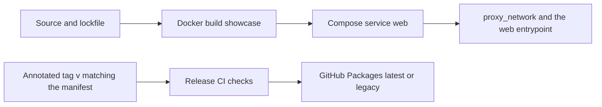

# BPS Kaltara Design System Operations

## Environment

| Environment | Configuration |
|---|---|
| Development | Vite http://localhost:5173 |
| Production showcase | Host design.kaltarastats.id in docker-compose.yml; internal 8081 |
| Library v4 | main, dist-tag latest |
| Library v3 legacy | v3, dist-tag legacy |

The HTTPS URL is used by the product documentation, but Compose sets the web entrypoint without a TLS label. The actual TLS termination, staging, SSH host/user/path, and contacts: to be filled in by the operator — not yet set; do not claim websecure is configured.

## Environment variables

The showcase declares no runtime credentials; Docker uses NODE_ENV=production. Publishing uses NODE_AUTH_TOKEN from the workflow GITHUB_TOKEN; consumers of the private registry use a read:packages token in the environment/home npmrc. Do not commit tokens. The registry scope @bpsprovkaltara points at https://npm.pkg.github.com.

## Build and image

A two-stage Dockerfile oven/bun:1.3.14-slim, install `bun install --frozen-lockfile --ignore-scripts` before the full source, then `bun run registry:build && bun run build` for the showcase. The runtime installs serve@14.2.4, copies dist, the non-root user bun, port 8081, and `bun run --bun serve dist -l 8081 -s -n` (SPA fallback without clipboard).

The library build produces ESM/CJS/types, the compiled styles.css, the raw tokens.css, and fonts.css. The dist output is shared with the showcase build; the library and Docker showcase artifacts must be built according to the target, not assuming one dist satisfies both.

## Registry

- `bun run registry:build` generates `registry.json` from the source (`scripts/build-registry.mjs`, including a self-check), then `shadcn build` writes `public/r/*.json`. Neither is committed.
- Vite copies `public/r/` to `dist/r/`, so the Docker build (and CI) runs `registry:build` before the showcase build.
- Public URL: `https://design.kaltarastats.id/r/<item>.json`. An application registers the namespace `@bps` in `components.json` and then `shadcn add @bps/<item>`.
- `registryDependencies` use absolute URLs. For a local test: `REGISTRY_BASE_URL=http://localhost:4010 bun run registry:build`, then serve `public/` on that port.
- The decision and its rules: `docs/adr/0003-distribute-via-shadcn-registry.md`.

## Deploy procedure



Traefik must already be running with the matching entrypoint; the external network proxy_network must be available.

```bash
docker network inspect proxy_network
# Only if the network is not available and the operator manages it:
docker network create proxy_network
docker build -t design-system:latest .
docker run --rm -p 8081:8081 design-system:latest
docker compose up -d --build
docker compose ps
docker compose logs --tail=100
```

Compose service web, container design-system, restart unless-stopped; router host design.kaltarastats.id, entrypoint web, backend port 8081. The Nginx comment in Compose is historical; the actual runtime is serve.

CI ci.yml on push/PR to main and v3: frozen install → typecheck → lint → client directive check → test → build:lib → build. Not a Docker deploy pipeline. release.yml on tag v*: install/typecheck/lint/test, match the tag with the package version, dist-tag legacy for major 3 and latest for other majors, publish to GitHub Packages (prepublishOnly build:lib). Official tags and the CHANGELOG are maintained; the annotated tag procedure is in the [release-tag skill](../.claude/skills/release-tag/SKILL.md). Do not publish/tag/push without an explicit request.

## Health check and monitoring

The showcase uses an SPA fallback, not a library HTTP health endpoint. Check the container status/logs and the HTTP root/deep route and the CSS/font assets. The Dockerfile sets no HEALTHCHECK. External monitoring, intervals, and escalation contacts: to be filled in by the operator — not yet set. A font CDN failure uses the fallback, not a reason for the app to stop.

## Backup and restore

There is no library/showcase database. Keep the source/tags/lockfile, the deploy configuration, and the accepted image so it can be rebuilt. Image retention, Traefik configuration, and host backup: to be filled in by the operator — not yet set. Do not put registry credentials in a public backup.

## Rollback

Compose currently builds from source, with no registry image tag; do not use docker compose pull as a sure rollback. Restore a known source/config revision, then docker compose up -d --build after the operator approves. Rollback image retention/tagging: to be filled in by the operator — not yet set. Library consumers pin the previous package version and review the breaking changes in [upgrading](upgrading.md); do not move a release tag that has already been published.

## Incident playbook

| Symptom | Check/action |
|---|---|
| 502/503/timeout | compose ps/logs, restart the web service, the proxy_network network and the host/port/entrypoint labels; check Traefik |
| Build fails | Bun/Node, `bun.lock`, typecheck, config, and peer dependencies; do not regenerate the lock without a reason |
| Old/missing styling | The package version and exports; non-Tailwind styles.css, Tailwind4 tokens.css + @source dist; import exactly once |
| Font fallback | index.html, Google Fonts network/CSP; consumers provide/self-host fonts; fonts.css is opt-in only |
| Publish fails | The tag/manifest match, packages:write permissions, and the registry; do not print the token |
| RSC component error | The client boundary and subpath/utility imports; do not add Next APIs to the showcase |

Self-hosting WOFF2 for the showcase has not been implemented. Production escalation priority/paths and host internet access: to be filled in by the operator — not yet set.
